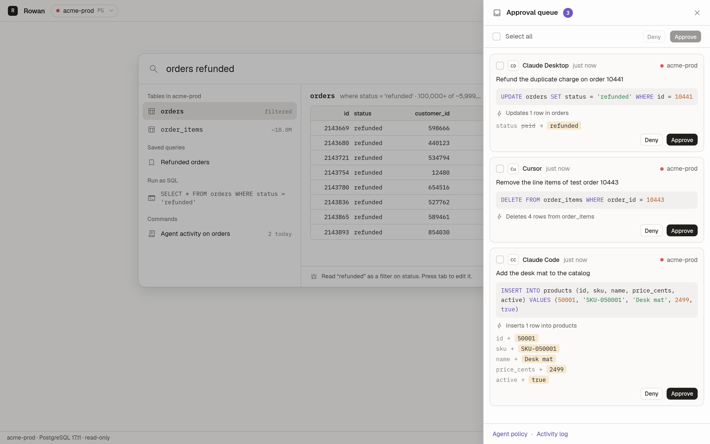

# Agents and MCP

Rowan runs an MCP server, so AI agents such as Claude Code, Claude Desktop and
Cursor can read your databases. You decide which connections an agent sees
and what it can do on each one. A write from an agent waits in an approval
queue until you approve or deny it.



## Connect a client

The MCP server starts with the app. It listens on `127.0.0.1:7421/mcp` and
speaks Streamable HTTP. To get a snippet with your path and token, open the
MCP server view in Rowan and choose your client.

### Claude Code

```sh
claude mcp add rowan -- /path/to/rowan mcp --stdio
```

### Claude Desktop

Add this to `claude_desktop_config.json`:

```json
{
  "mcpServers": {
    "rowan": {
      "command": "/path/to/rowan",
      "args": ["mcp", "--stdio"]
    }
  }
}
```

### Cursor and other HTTP clients

Add this to `~/.cursor/mcp.json`. Replace the token with the content of the
`mcp-token` file in the [config directory](configuration.md#files):

```json
{
  "mcpServers": {
    "rowan": {
      "url": "http://127.0.0.1:7421/mcp",
      "headers": { "Authorization": "Bearer <token>" }
    }
  }
}
```

### The stdio bridge

`rowan mcp --stdio` starts a small bridge. It forwards MCP messages on stdin
and stdout to the running app. Use it for clients that speak only stdio.
When the app is not running, the bridge still answers `initialize` and
`tools/list`. Each tool call then returns an error that tells the user to
open Rowan.

## Tools

| Tool | Arguments | What it does |
|---|---|---|
| `list_connections` | none | Lists the connections that you share with agents, with the engine, access level and row limit |
| `list_tables` | `connection`, optional `schema` and `filter` | Lists the tables and views, with estimated row counts |
| `describe_table` | `connection`, `table` | Returns the columns, types, keys, indexes and references of one table |
| `query` | `connection`, `sql` | Runs one read-only statement. The result stops at the row limit |
| `explain` | `connection`, `sql` | Returns the plan without running the statement. Rowan refuses `ANALYZE` |
| `execute` | `connection`, `sql`, `reason` | Runs one write on a read-write connection. With approvals on, the call waits for you |

`list_tables` returns at most 200 tables. A larger list also gives the total
and the table count of each schema. The agent can then ask for one schema,
or for the names that contain a word:

```json
{ "connection": "acme-prod", "schema": "billing" }
{ "connection": "acme-prod", "filter": "invoice" }
```

To turn a tool off for all agents, use its switch in the MCP server view.

## Policies

Each connection has its own agent policy. Set it in the MCP server view.

| Setting | Default | Effect |
|---|---|---|
| Shared | off | Agents see the connection only when it is shared |
| Access | read-only | `read-write` lets agents call `execute` |
| Approve writes | on | Each write waits for your decision. Production connections always ask |
| Row limit | 500 | The most rows that one `query` call returns |
| Table allowlist | empty | When it is set, agents can read only these tables |

A new connection always starts with the default policy, so it is hidden and
read-only for agents until you change it.

To set the allowlist, click **All tables** in the row of the connection, then
click a table to hide it or show it. When a connection has more than 40
tables, type part of a name to filter the list.

A statement that names a table outside the allowlist is blocked. Rowan does
not check the tables that a view reads. To protect such data, use grants in
the database.

## The approval queue

An `execute` call with approvals on does not reach the database. It waits in
the approval queue. Each item shows:

- the agent and the connection
- the reason that the agent gave
- the SQL
- the impact: the number of rows that change, counted with the read pool
- for an `UPDATE` or `INSERT`, the old and the new values

Rowan never runs a write to compute the impact. Approve or deny one item, or
select more than one item and decide for all of them. The agent gets the
result of the write, or a message that you denied it.

The workspace layout shows the queue in the live agent feed. In the command
layout, open it from the queue button in the title bar.

## Security

- The server listens on `127.0.0.1` only.
- Every request needs the bearer token from `mcp-token`. The file has mode
  0600.
- Rowan refuses requests that carry an `Origin` header. This blocks web pages
  and DNS rebinding.
- `query` and `explain` run on the read-only pool. A write fails in the
  database even if a check in Rowan misses it. See [Safety](safety.md).
- To block one client, click **Block** next to it in the MCP server view.
  Rowan refuses its calls and logs them.

## Activity log

Rowan logs every agent call, also the blocked and denied ones. The Activity
log view shows the newest calls. The file `activity.jsonl` keeps all of them,
one JSON object per line.
