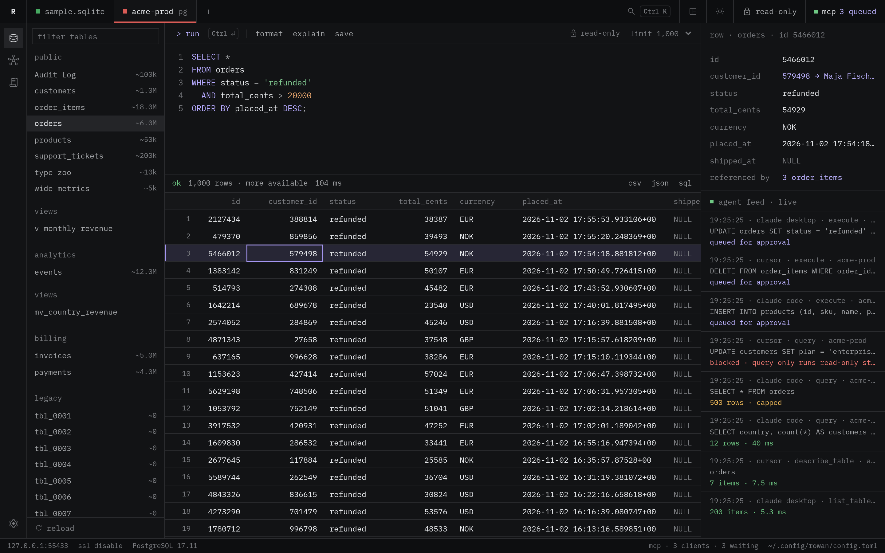

# Getting started

This page takes you from the download to your first query on your own
database.

## Install

Download the build for your system from the releases page of the repository.

| System | File |
|---|---|
| Linux x86-64 | `rowan-<version>-linux-amd64.tar.gz` |
| Linux ARM64 | `rowan-<version>-linux-arm64.tar.gz` |
| macOS, Apple silicon and Intel | `rowan-<version>-macos-universal.zip` |
| Windows x86-64 | `rowan-<version>-windows-amd64-installer.exe` or the portable `rowan-<version>-windows-amd64.zip` |

### Linux

Rowan needs GTK 3 and WebKitGTK 4.1. On Debian and Ubuntu:

```sh
sudo apt install libgtk-3-0 libwebkit2gtk-4.1-0
tar -xzf rowan-<version>-linux-amd64.tar.gz
./rowan-<version>-linux-amd64/rowan
```

The archive also holds `rowan.desktop` and `rowan.png` for your application
menu.

### macOS

Unzip the file and move `rowan.app` to `/Applications`. The build is not
notarized unless the release says so. If macOS blocks the first start,
right-click the app, choose **Open**, and confirm.

### Windows

Run the installer, or unzip the portable build and start `rowan.exe`. The
build is not signed, so SmartScreen can ask you to confirm the first start.

To check a download, compare it with `SHA256SUMS` from the same release. See
[Releasing](releasing.md) for the commands.

## First launch

On the first launch, Rowan writes its config directory and a sample SQLite
database, `sample.sqlite`. The sample has customers, products, orders, order
items and invoices, so you can try every feature before you connect a real
database.

## Add a connection

1. Open the connection dialog. In the workspace layout, click `+` in the tab
   bar. In the command layout, use the connection menu in the title bar.
2. Choose PostgreSQL, MySQL or SQLite.
3. Enter the host, port, database, user and password. For SQLite, choose the
   file.
4. To connect through a bastion host, turn on SSH and enter its host, user
   and key.
5. Click **Test connection**, then **Save**.

Mark the connection as production when it is one. A production connection
asks you to type its name before it unlocks writes.

## Choose a layout

Rowan has two layouts. Both use the same data, safety model and dialogs.

- **Command.** One search box with a live preview. Type a table name and
  filters, such as `orders refunded`, and press `Enter`.
- **Workspace.** Connections are tabs. The editor and the grid stack in the
  center. A row inspector and a live agent feed sit on the right.

To switch, click the layout button in the title bar, or press `Ctrl+K` and
choose the switch command.



## Keys

| Key | Action |
|---|---|
| `Ctrl+K` | Open the search box |
| `Ctrl+Enter` | Run the script or the selection |
| `Ctrl+Space` | Open the completion list |
| `Tab` | Insert the completion item, or indent |
| `Esc` | Close the list, the dialog or the drawer |

On macOS, use `⌘` for `Ctrl`.

## Next steps

- [Querying](querying.md): search syntax, the editor, completion and results.
- [Safety](safety.md): how read-only mode and unlocks work.
- [Agents and MCP](agents.md): connect Claude Code, Claude Desktop or Cursor.
