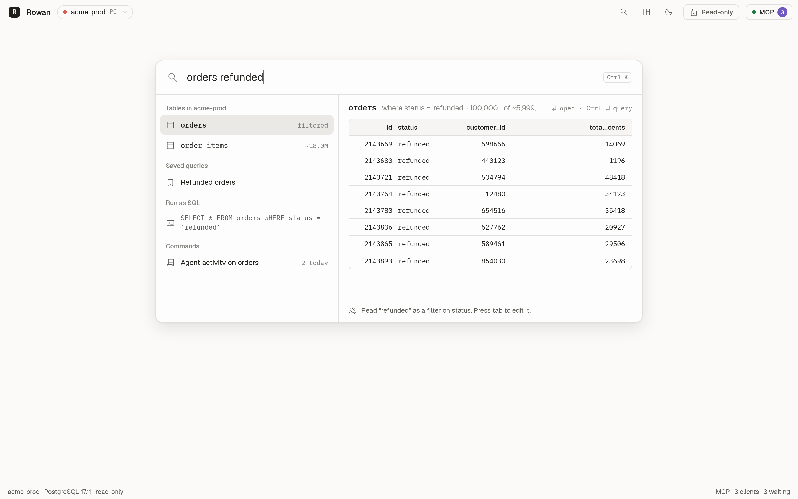
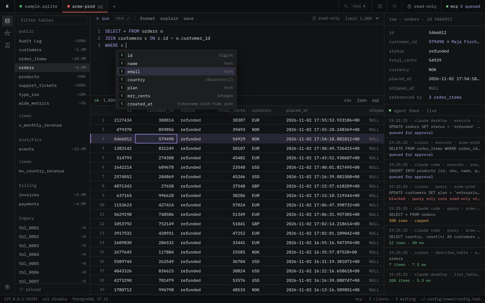

# Querying

This page covers the search surface, the SQL editor, completion, results and
the row inspector.

## Search

The command layout opens on one search box. The workspace layout opens the
same box with `Ctrl+K`, or `⌘K` on macOS. The first word picks a table. The
other words become filters. The preview runs while you type.

| Input | Filter |
|---|---|
| `orders refunded` | `status = 'refunded'`, because `refunded` is a value of `status` |
| `orders 10442` | `id = 10442`. A number filters the primary key |
| `orders status:shipped` | `status = 'shipped'` |
| `orders total_cents>5000` | `total_cents > 5000` |
| `customers email~acme` | `email` contains `acme` |
| `orders shipped_at:null` | `shipped_at IS NULL` |

A bare word matches a value of a column with few distinct values. Rowan
reads these values from the first 500 rows of the table. For an enum column
in PostgreSQL, Rowan reads the values from the catalog.

- Press `Tab` to write the filters in `column:value` form, so you can edit
  them.
- Press `Enter` to open the table.
- Press `Ctrl+Enter` to open the query in the editor.
- Type SQL to run it as a read-only preview.

The search box also finds saved queries and commands, such as the layout
switch.

## The editor

- Press `Ctrl+Enter`, or `⌘Enter` on macOS, to run the script. When text is
  selected, Rowan runs only the selection.
- **format** rewrites the SQL with one clause on each line.
- **explain** shows the plan of the statement.
- **save** adds the SQL to the saved queries. A first line such as
  `-- Unpaid invoices` becomes the name.
- The limit menu sets how many rows a query fetches. The default is 1,000.

Rowan keeps a draft of the editor for each connection. The draft is still
there when you open the app again.

## Completion

The editor completes tables, columns, keywords and functions while you type.
The list depends on the position of the caret in the statement.

- After `FROM`, `JOIN`, `UPDATE` and `INTO`, the list shows tables and views.
  A common table expression from `WITH` is also a table.
- After `SELECT`, `WHERE`, `ON`, `SET` and `ORDER BY`, the list shows the
  columns of the tables in the statement. This includes subqueries.
- After `alias.` or `table.`, the list shows the columns of that table.
- After `INSERT INTO orders (`, the list shows only the columns of `orders`.
- On PostgreSQL, the list shows schemas. After `schema.`, it shows the tables
  in that schema.

When two tables in the statement have a column with the same name, Rowan
inserts the column with its alias, such as `o.id`. Keywords follow the case
that you type. A function inserts with its parentheses, and you can type `)`
to step over the closing parenthesis.

| Key | Action |
|---|---|
| `Tab` or `Enter` | Insert the selected item |
| `↑` and `↓` | Select an item |
| `Esc` | Close the list |
| `Ctrl+Space` | Open the list at the caret |

`Enter` on a word that is already complete adds a new line. `Ctrl+Z` undoes
an insert.

The editor colors only the lines near the view, so a script of thousands of
lines types and scrolls at the same speed as a short one. A paste of 4,000
characters or more goes in at once. `Ctrl+Z` undoes it, and `Ctrl+Shift+Z`
or `Ctrl+Y` redoes it.

The list does not open inside strings and comments, after `AS`, or for a
short word after a table name. This keeps an alias such as `o` from turning
into `ON` when you press `Enter`.

When the editor gets focus, Rowan loads the columns of all tables in one
catalog query. If the schema has more than 20,000 columns, Rowan loads the
columns of a table when a statement names it. A write reloads the columns.

## Results

The grid shows the first rows up to the limit. The status bar shows the row
count, the time, and **more available** when the query has more rows.

Rowan sends the limit to the server with the query, so the server stops after
the limit and plans for that number of rows. A sort over millions of rows
then uses a top-N sort or an index, and returns in milliseconds instead of
seconds. You do not have to add `LIMIT` yourself.

- On PostgreSQL, Rowan runs a `SELECT`, `WITH`, `VALUES` or `TABLE`
  statement as `SELECT * FROM (statement) rowan_q LIMIT n`.
- On MySQL, Rowan adds the optimizer hint
  `/*+ SET_VAR(sql_select_limit = n) */` after `SELECT`. A `LIMIT` in your
  statement takes precedence.
- Rowan does not change a statement with `INTO` or a locking clause such as
  `FOR UPDATE`.

The grid renders only the rows and the columns in view. A result with 10,000
rows or 120 columns scrolls at full frame rate.

- Click a column header to sort the rows that the grid holds.
- Export the result as CSV, JSON or SQL `INSERT` statements with the buttons
  in the status bar.
- A script with more than one statement shows the result of the last one.

## Row inspector

Click a row to see all of its values in the row inspector. For a query on one
table, the inspector also follows the keys:

- A foreign key shows the label of the row that it points to, such as
  `579498 → Maja Fischer`. Click it to open that row.
- **referenced by** counts the rows in other tables that point to this row.
  Click a count to open those rows. When the referencing column has no index,
  Rowan shows the table without a count, because the count reads the whole
  table.

The label comes from the first column with a common name, such as `name`,
`title`, `email` or `number`.
