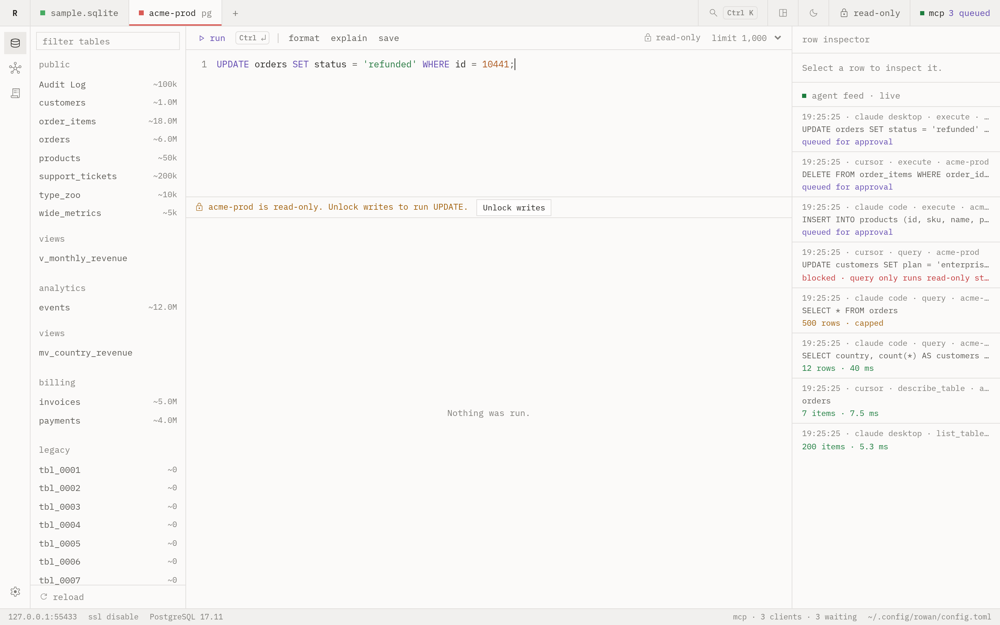

# Safety

Rowan opens every connection read-only. You can browse a production database
without the risk of a stray write. To write, you unlock the connection for a
fixed time.

## Read-only at the database level

Rowan keeps two connection pools for each database. The read pool asks the
database itself to refuse writes:

| Engine | Setting on the read pool |
|---|---|
| PostgreSQL | `default_transaction_read_only = on` |
| MySQL | `transaction_read_only = ON` |
| SQLite | `PRAGMA query_only = 1` |

A write on the read pool fails in the database, even if a check in Rowan
misses it. The search preview, the row inspector, the impact preview and the
agent tools `query` and `explain` use the read pool.

## Writes need an unlock

Rowan classifies each statement before it runs. A write on a locked
connection does not reach the database. The status bar shows the reason and
an **Unlock writes** button.

1. Click **Unlock writes**, or the lock in the title bar.
2. Choose 5, 15, 30 or 60 minutes, or **Until relaunch**.
3. Run the statement again.

When the time is over, Rowan relocks the connection and closes its write
pool. To relock early, click the lock again.

These statements count as writes:

- `INSERT`, `UPDATE`, `DELETE`, `MERGE` and DDL such as `CREATE` and `DROP`.
- Statements that lift read-only mode, such as
  `SET default_transaction_read_only = off`, `BEGIN READ WRITE` and
  `PRAGMA query_only = 0`.

## Production connections

Mark a connection as production in its settings. A production connection
asks you to type its name before it unlocks. An agent write on a production
connection always waits for your approval, also when approvals are off in its
policy.

## Destructive statements

These statements ask for a confirmation before they run:

- `DROP` and `TRUNCATE`
- `DELETE` without `WHERE`
- `UPDATE` without `WHERE`

To turn the confirmation off, clear `confirm_destructive` in
[config.toml](configuration.md#safety).

## Session state

A script can change the state of its database session with `SET`, `USE` or
its own `BEGIN`. Rowan closes that connection after the script. It does not
return the connection to the pool, so the next query starts clean.

## Statement timeout

Each statement stops after `statement_timeout`, 60 seconds by default. To stop
a statement early, click **stop** in the editor toolbar.

## Passwords

Rowan stores passwords in the system keychain. If the keychain is not
available, Rowan stores them in `credentials.json` with mode 0600 and tells
you. `config.toml` never holds a password.
